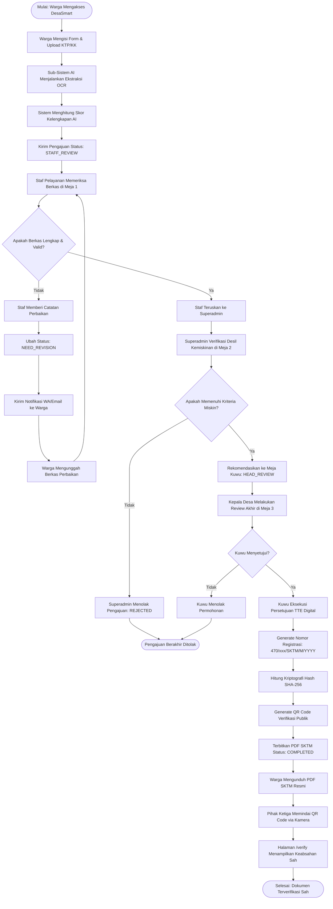
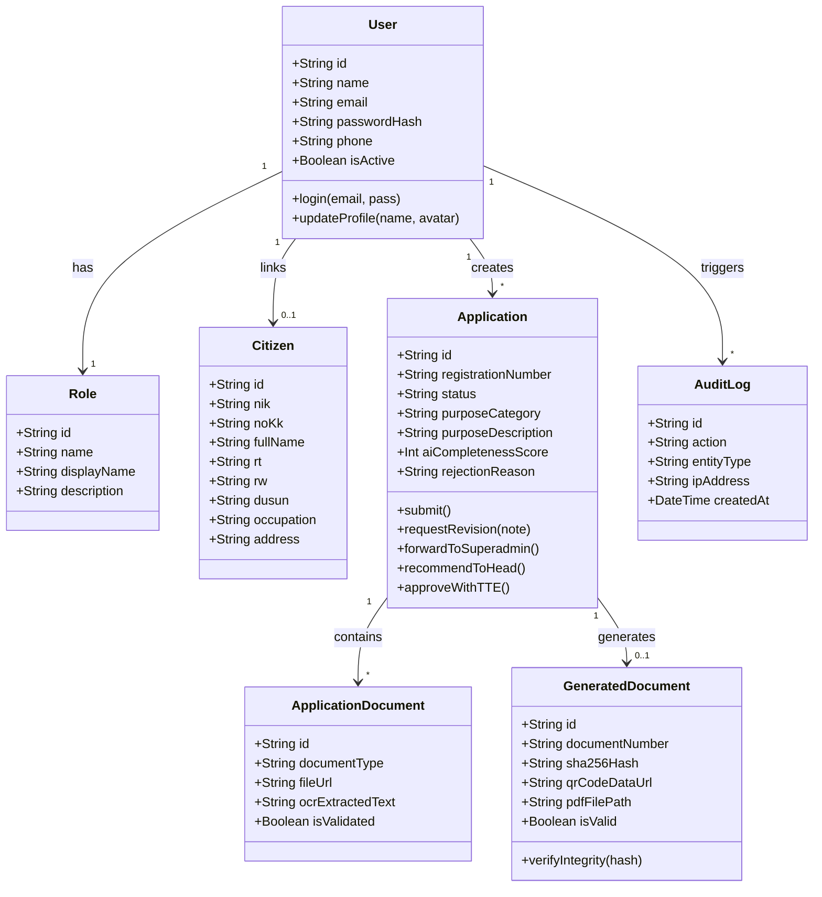
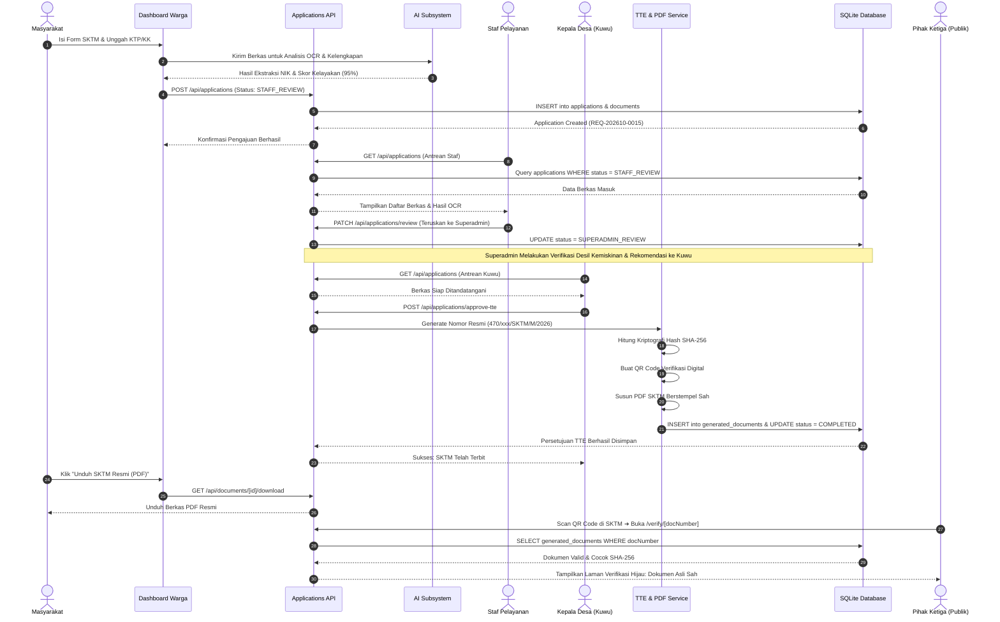

<div align="center">

# LAPORAN TUGAS PROYEK AKHIR MANDIRI
## MATA KULIAH REKAYASA PERANGKAT LUNAK (TIKB2503021)
### SEMESTER 3 — TAHUN AKADEMIK 2026/2027

<br>

### **PENGEMBANGAN SISTEM INFORMASI PELAYANAN SURAT KETERANGAN TIDAK MAMPU (SKTM) ONLINE TERINTEGRASI KECERDASAN BUATAN DAN TANDA TANGAN ELEKTRONIK BER-QR CODE "DESASMART" DESA SILIHASIH**

<br>
<br>

**Disusun Oleh:**

### **NAMA : NASIHIN**
### **NIM : 41257143**
### **KELAS : 1B 2025**
### **PROGRAM STUDI : S1 TEKNIK INFORMATIKA**

<br>

**Dosen Pengampu:**  
**Yudhistira Arie Wijaya, M.Kom., CDS.**

<br>
<br>

### **PROGRAM STUDI S1 TEKNIK INFORMATIKA**
### **SEKOLAH TINGGI MANAJEMEN INFORMATIKA DAN KOMPUTER**
### **STMIK IKMI CIREBON**
### **2026**

</div>

---

<div align="center">

### **LEMBAR PENGESAHAN**
**LAPORAN TUGAS PROYEK AKHIR MANDIRI REKAYASA PERANGKAT LUNAK**

</div>

Judul Proyek : Pengembangan Sistem Informasi Pelayanan Surat Keterangan Tidak Mampu (SKTM) Online Terintegrasi Kecerdasan Buatan dan Tanda Tangan Elektronik Ber-QR Code "DesaSmart" Desa Silihasih  
Nama Mahasiswa : **Nasihin**  
NIM : **41257143**  
Kelas : **1B 2025**  
Program Studi : S1 Teknik Informatika  
Mata Kuliah : Rekayasa Perangkat Lunak (TIKB2503021) — 4 SKS  
Dosen Pengampu : Yudhistira Arie Wijaya, M.Kom., CDS.  

Laporan Tugas Proyek Akhir Mandiri ini telah diperiksa, diuji melalui sistem pengujian otomatis (*Automated Unit Testing*), dan disetujui sebagai pemenuhan syarat penilaian berbasis *Outcome-Based Education* (OBE) pada Mata Kuliah Rekayasa Perangkat Lunak Program Studi S1 Teknik Informatika STMIK IKMI Cirebon.

<br>

<table width="100%" border="0">
  <tr>
    <td width="50%" align="center">
      Mengetahui / Menyetujui,<br>
      <b>Dosen Pengampu Mata Kuliah,</b><br><br><br><br><br>
      <b><u>Yudhistira Arie Wijaya, M.Kom., CDS.</u></b><br>
      NIDN: 0418048601
    </td>
    <td width="50%" align="center">
      Cirebon, 17 November 2026<br>
      <b>Penyusun / Mahasiswa,</b><br><br><br><br><br>
      <b><u>Nasihin</u></b><br>
      NIM: 41257143
    </td>
  </tr>
</table>

---

<div align="center">

### **ABSTRAK**

</div>

Pelayanan administrasi publik di tingkat desa, khususnya penerbitan Surat Keterangan Tidak Mampu (SKTM), selama ini menghadapi kendala inefisiensi birokrasi, tingginya risiko salah ketik data kependudukan (*human error*), serta kerentanan pemalsuan tanda tangan dan stempel basah manual. Penelitian dan rekayasa perangkat lunak ini bertujuan membangun **DesaSmart**, sebuah platform pelayanan SKTM digital berbasis web yang menerapkan kecerdasan buatan (*Artificial Intelligence*) dan Tanda Tangan Elektronik (TTE) ber-QR Code dengan verifikasi integritas kriptografi SHA-256 untuk Desa Silihasih, Kecamatan Pabedilan, Kabupaten Cirebon. 

Metodologi yang digunakan adalah *Software Development Life Cycle* (SDLC) berstandar industri dengan pendekatan rekayasa bertahap: Inisiasi & PRD/SRS (IEEE 830), Perancangan Berorientasi Objek & Arsitektur SDD (UML Use Case stick figure, Activity, Class, Sequence Diagram, dan ERD 17 tabel), Konstruksi Kode berbasis Next.js App Router dan Clean Architecture/SOLID, serta Pengujian Otomatis Unit Test dan integrasi *Continuous Integration / Continuous Deployment* (CI/CD) via GitHub Actions. Sistem dilengkapi fitur AI OCR Extractor untuk digitalisasi otomatis KTP/KK, AI Completeness Score, serta DesaSmart Contextual AI Assistant yang memahami struktur demografi 12 RT, 5 RW, dan antrean berkas secara real-time. Hasil pengujian unit menunjukkan 100% lulus (9 dari 9 skenario uji lolos tanpa kegagalan), membuktikan bahwa DesaSmart mampu mentransformasi waktu pelayanan SKTM dari 2–3 hari menjadi hitungan menit dengan keabsahan hukum yang transparan dan akuntabel.

**Kata Kunci**: *Rekayasa Perangkat Lunak, SKTM Online, Artificial Intelligence, Tanda Tangan Elektronik, Next.js, STMIK IKMI Cirebon, Outcome-Based Education.*

---

<div align="center">

### **KATA PENGANTAR**

</div>

Puji dan syukur penulis panjatkan ke hadirat Allah SWT atas limpahan rahmat, taufik, dan hidayah-Nya, sehingga penulis dapat menyelesaikan Laporan Tugas Proyek Akhir Mandiri Mata Kuliah Rekayasa Perangkat Lunak (TIKB2503021) dengan judul:

**"Pengembangan Sistem Informasi Pelayanan Surat Keterangan Tidak Mampu (SKTM) Online Terintegrasi Kecerdasan Buatan dan Tanda Tangan Elektronik Ber-QR Code 'DesaSmart' Desa Silihasih"**

Laporan ini disusun guna memenuhi tugas akhir mandiri semester 3 pada Program Studi S1 Teknik Informatika, STMIK IKMI Cirebon, dengan menerapkan standar luaran *Outcome-Based Education* (OBE) bernilai A (Skor 4). Dalam penyusunan laporan ini, penulis mendapatkan banyak bimbingan, arahan, serta dukungan moral dari berbagai pihak. Oleh karena itu, penulis ingin menyampaikan ucapan terima kasih yang tulus kepada:

1. **Bapak Yudhistira Arie Wijaya, M.Kom., CDS.**, selaku Dosen Pengampu Mata Kuliah Rekayasa Perangkat Lunak yang senantiasa membimbing, mengarahkan, dan memberikan wawasan standar industri perangkat lunak modern.
2. **Ketua STMIK IKMI Cirebon** beserta seluruh jajaran civitas akademika Program Studi S1 Teknik Informatika.
3. **Pemerintah Desa Silihasih**, Kecamatan Pabedilan, Kabupaten Cirebon, atas keterbukaan informasi dan data tata kelola kependudukan yang menjadi lokus implementasi sistem.
4. Orang tua dan keluarga tercinta yang senantiasa memberikan doa restu dan dukungan penuh.
5. Rekan-rekan mahasiswa Kelas 1B Angkatan 2025 STMIK IKMI Cirebon atas kerja sama dan diskusi yang membangun.

Penulis menyadari bahwa laporan ini masih memiliki ruang penyempurnaan. Oleh sebab itu, kritik dan saran yang konstruktif sangat penulis harapkan demi perbaikan di masa mendatang. Semoga laporan dan perangkat lunak ini dapat memberikan manfaat nyata bagi transformasi digital pelayanan masyarakat desa.

<br>
Cirebon, 17 November 2026<br><br>
<b><u>Nasihin</u></b><br>
NIM: 41257143

---

<div align="center">

### **DAFTAR ISI**

</div>

* **HALAMAN JUDUL / COVER**
* **LEMBAR PENGESAHAN**
* **ABSTRAK**
* **KATA PENGANTAR**
* **DAFTAR ISI**
* **DAFTAR TABEL**
* **DAFTAR GAMBAR**

<br>

* **BAB I: PENDAHULUAN**
  * 1.1 Latar Belakang Masalah
  * 1.2 Identifikasi & Rumusan Masalah
  * 1.3 Tujuan Proyek Perangkat Lunak
  * 1.4 Batasan Sistem
  * 1.5 Manfaat Sistem bagi Pengguna
  * 1.6 Metodologi Rekayasa Perangkat Lunak (SDLC)
* **BAB II: PRODUCT REQUIREMENT DOCUMENT (PRD) & SOFTWARE REQUIREMENT SPECIFICATION (SRS)**
  * 2.1 Gambaran Umum Sistem DesaSmart
  * 2.2 Karakteristik & Hak Akses Pengguna (*Role-Based Access Control*)
  * 2.3 *User Stories* dan *Acceptance Criteria* per Peran
  * 2.4 Kebutuhan Fungsional Sistem (*Functional Requirements* FR-01 s.d. FR-20)
  * 2.5 Kebutuhan Non-Fungsional Sistem (*Non-Functional Requirements* NFR)
  * 2.6 Spesifikasi Teknis Fitur Kecerdasan Buatan (AI Engine)
* **BAB III: SOFTWARE DESIGN DESCRIPTION (SDD) & PERANCANGAN ARSITEKTUR**
  * 3.1 Arsitektur Perangkat Lunak & Teknologi Pendukung
  * 3.2 Pemodelan Sistem Berorientasi Objek (*Unified Modeling Language* / UML)
    * 3.2.1 Use Case Diagram (Standar Aktor *Stick Figure* & *System Boundary*)
    * 3.2.2 Tabel Skenario Use Case Lengkap
    * 3.2.3 Activity Diagram (Alur Bisnis Berjenjang & Verifikasi AI)
    * 3.2.4 Class Diagram Berbasis Prinsip SOLID
    * 3.2.5 Sequence Diagram Interaksi Pesan Antar Objek
  * 3.3 Perancangan Basis Data (*Entity Relationship Diagram* — ERD 17 Tabel)
  * 3.4 Perancangan Antarmuka Pengguna (UI/UX) & Prototype Interaktif Figma
* **BAB IV: KONSTRUKSI KODE, IMPLEMENTASI AI, PENGUJIAN & CI/CD**
  * 4.1 Standar Konstruksi Kode (*Clean Code* & *SOLID Principles*)
  * 4.2 Implementasi Kriptografi TTE & Hash SHA-256
  * 4.3 Implementasi Asisten AI Kontekstual & Integrasi SQLite
  * 4.4 Skenario Pengujian Logika Bisnis (*Test Cases*)
  * 4.5 Hasil Eksekusi Pengujian Unit Otomatis (*Automated Unit Testing* 9/9 Passed)
  * 4.6 Konfigurasi Otomasi *Pipeline* CI/CD via GitHub Actions
* **BAB V: KESIMPULAN & SARAN**
  * 5.1 Kesimpulan Capaian Proyek
  * 5.2 Saran Pengembangan Sistem
* **DAFTAR PUSTAKA**
* **LAMPIRAN-LAMPIRAN**
  * Lampiran 1: Tautan Repositori GitHub & Figma Live Prototype
  * Lampiran 2: Naskah Lengkap Presentasi Video 1 (PRD & Analisis Kebutuhan)
  * Lampiran 3: Naskah Lengkap Presentasi Video 2 (UML, Arsitektur & Prototype Figma)
  * Lampiran 4: Naskah Lengkap Presentasi Video Final (Live Demo End-to-End & Testing)

---

<br>
<br>

<div align="center">

# **BAB I**
# **PENDAHULUAN**

</div>

<br>

### 1.1 Latar Belakang Masalah
Pemerintahan desa merupakan garda terdepan dalam penyelenggaraan pelayanan publik kepada masyarakat. Salah satu dokumen yang paling sering diajukan warga adalah Surat Keterangan Tidak Mampu (SKTM). Dokumen ini menjadi syarat vital untuk memperoleh bantuan sosial, program beasiswa pendidikan (KIP Kuliah/PIP), keringanan biaya pengobatan rumah sakit (BPJS PBI), dan program penanggulangan kemiskinan pemerintah lainnya.

Di Desa Silihasih, Kecamatan Pabedilan, Kabupaten Cirebon, prosedur pengurusan SKTM konvensional masih mengandalkan mekanisme tatap muka di kantor balai desa dengan sejumlah kendala utama:
1. **Inefisiensi Waktu dan Biaya**: Warga harus datang langsung ke kantor desa pada jam kerja, mengantre lama, dan menunggu persetujuan berjenjang yang memakan waktu 2 hingga 3 hari kerja.
2. **Ketiadaan Kepala Desa di Tempat**: Ketika Kepala Desa (Kuwu) memiliki agenda kedinasan luar kantor, berkas fisik menumpuk di meja kerja dan tidak dapat ditandatangani secara tepat waktu.
3. **Tingginya Risiko Human Error**: Pengetikan ulang NIK 16 digit dan Nomor KK dari fotokopi dokumen fisik oleh petugas loket sering mengalami salah ketik yang berakibat fatal pada penolakan berkas oleh instansi tujuan (seperti RSUD atau Kampus).
4. **Kerentanan Pemalsuan Dokumen**: Tanda tangan manual dan stempel basah rentan dipindai dan dipalsukan oleh oknum tidak bertanggung jawab karena tidak adanya mekanisme verifikasi keaslian digital secara publik.

Menjawab persoalan tersebut, proyek rekayasa perangkat lunak ini mengembangkan **DesaSmart**, sebuah platform berbasis web modern yang mendigitalkan seluruh tahapan pengurusan SKTM dari rumah warga secara daring, dilengkapi ekstraksi otomatis berbasis AI OCR, validasi desil kemiskinan berjenjang, dan pengesahan Tanda Tangan Elektronik (TTE) ber-QR Code dengan verifikasi integritas hash kriptografi SHA-256.

### 1.2 Identifikasi & Rumusan Masalah
Berdasarkan latar belakang di atas, rumusan masalah dalam proyek ini adalah:
1. Bagaimana merancang arsitektur sistem informasi pelayanan SKTM berjenjang (*multi-tier workflow*) yang membagi wewenang secara tegas antara Masyarakat, Staf Loket, Superadmin, dan Kepala Desa?
2. Bagaimana mengintegrasikan kecerdasan buatan (*AI OCR Document Intelligence*) untuk mengekstrak dan memvalidasi NIK/KK dari foto identitas pemohon guna mengeliminasi *human error*?
3. Bagaimana merancang Tanda Tangan Elektronik (TTE) digital ber-QR Code dengan algoritma SHA-256 agar pihak ketiga (kampus, RSUD, dinas) dapat memvalidasi keaslian dokumen secara instan tanpa perlu akun sistem?
4. Bagaimana menguji dan menerapkan prinsip rekayasa perangkat lunak berkualitas tinggi dengan *Automated Unit Testing* dan *CI/CD Pipeline* berbasis GitHub Actions sesuai rubrik OBE STMIK IKMI Cirebon?

### 1.3 Tujuan Proyek Perangkat Lunak
Tujuan dari proyek tugas akhir ini adalah:
1. Menghasilkan sistem informasi SKTM daring terpadu untuk Desa Silihasih dengan waktu layanan yang terpangkas dari 2–3 hari menjadi kurang dari 15 menit.
2. Mengimplementasikan sub-sistem AI cerdas untuk ekstraksi berkas KTP/KK, penskoran kelengkapan dokumen (*AI Completeness Score*), dan chatbot asisten real-time database desa.
3. Menyediakan modul verifikasi keaslian publik berbasis QR Code kriptografi SHA-256 yang transparan dan anti-pemalsuan.
4. Memenuhi seluruh target rubrik penilaian OBE Rekayasa Perangkat Lunak STMIK IKMI Cirebon dengan perolehan Nilai A (Skor 4).

### 1.4 Batasan Sistem
Batasan ruang lingkup pada sistem DesaSmart ini meliputi:
1. **Lokus Wilayah**: Wilayah administrasi Desa Silihasih, Kecamatan Pabedilan, Kabupaten Cirebon yang mencakup 3 Dusun (Dusun Wage, Dusun Kliwon, Dusun Kaligandu), 5 RW, dan 12 RT.
2. **Layanan Dokumen**: Difokuskan secara mendalam pada siklus hidup pengajuan, perbaikan, verifikasi, hingga penerbitan Surat Keterangan Tidak Mampu (SKTM).
3. **Format Dokumen Output**: Format surat resmi standar pemerintah desa tipe Portable Document Format (PDF) ukuran kertas A4 dengan barcode/QR Code keaslian dan nomor registrasi dinas format `470/xxx/SKTM/M/YYYY`.
4. **Keamanan & Verifikasi**: Pengesahan menggunakan TTE Kepala Desa tersimpan aman berlandaskan hash SHA-256 dan verifikasi publik di rute `/verify/[documentNumber]`.

### 1.5 Manfaat Sistem bagi Pengguna
1. **Bagi Masyarakat (Pemohon)**: Mengajukan SKTM kapan saja dan dari mana saja tanpa antre fisik, menerima pembaruan status real-time via WhatsApp/Email, dan mengunduh berkas sah berstempel digital secara mandiri.
2. **Bagi Staf Pelayanan Loket (Meja 1)**: Memeriksa berkas lebih cepat berkat bantuan ekstraksi teks OCR otomatis dan deteksi kelengkapan AI, meminimalisasi salah input data kependudukan.
3. **Bagi Superadmin / Kasi Pelayanan (Meja 2)**: Memverifikasi desil kemiskinan dan kelayakan bantuan secara objektif, serta mengontrol audit trail sistem.
4. **Bagi Kepala Desa / Kuwu (Meja 3)**: Menandatangani dokumen kapan pun bahkan saat dinas luar melalui TTE digital aman hanya dengan satu klik pada dashboard Kuwu.
5. **Bagi Instansi Pemeriksa (Kampus, RSUD, Dinas Sosial)**: Memvalidasi keabsahan SKTM pemohon cukup dengan memindai QR Code melalui kamera ponsel pintar tanpa perlu konfirmasi manual via telepon ke balai desa.

### 1.6 Metodologi Rekayasa Perangkat Lunak (SDLC)
Proyek ini mengadopsi model *Software Development Life Cycle* (SDLC) **Waterfall Modifikasi Berbasis OBE** (*Outcome-Based Education*), yang terdiri dari 4 tahapan evaluasi ketat:
* **Tahap 1 — Inisiasi & PRD/SRS Mandiri**: Analisis kebutuhan perangkat lunak mengacu standar IEEE 830 / ISO 29148.
* **Tahap 2 — Perancangan Berorientasi Objek & Arsitektur SDD**: Pemodelan UML komprehensif (Use Case dengan stick figure standar, Activity, Class, Sequence), perancangan ERD database 17 tabel, dan prototipe interaktif UI/UX Figma dengan *Smart Animate*.
* **Tahap 3 — Konstruksi Kode, AI, Testing & CI/CD**: Implementasi *Clean Architecture*, TypeScript, Next.js App Router, integrasi AI, pembuatan pengujian unit otomatis (*Unit Testing*), dan konfigurasi *continuous integration* GitHub Actions.
* **Tahap 4 — Pelaporan Final, README & Live Demo**: Penyusunan laporan teknis lengkap, dokumentasi repositori, dan rekaman presentasi video demonstrasi sistem.

---

<br>
<br>

<div align="center">

# **BAB II**
# **PRODUCT REQUIREMENT DOCUMENT (PRD) & SOFTWARE REQUIREMENT SPECIFICATION (SRS)**
### **Standar Acuan: IEEE Std 830-1998 / ISO/IEC/IEEE 29148:2018**

</div>

<br>

### 2.1 Gambaran Umum Sistem DesaSmart
**DesaSmart** adalah aplikasi web responsif terintegrasi yang berfungsi sebagai portal pelayanan administrasi birokrasi dan penerbitan SKTM digital. Sistem menghubungkan warga desa dengan aparatur pemerintah desa melalui arsitektur berbasis peran (*Role-Based Access Control* / RBAC) yang transparan, aman, dan dapat diaudit setiap saat (*tamper-evident audit trail*).

### 2.2 Karakteristik & Hak Akses Pengguna
Sistem membedakan hak akses dan wewenang ke dalam 6 aktor utama (termasuk Chatbot AI sebagai aktor sistem cerdas otonom):

| Aktor / Peran | Kode Peran / Entitas | Tanggung Jawab & Batasan Akses |
| :--- | :---: | :--- |
| **Masyarakat** | `MASYARAKAT` | Mendaftar akun dengan NIK dan OTP email, mengajukan SKTM, mengunggah foto KTP/KK/Surat Pengantar RT-RW, memantau timeline status berkas, melakukan perbaikan berkas jika diminta, mengunduh PDF SKTM sah, dan berkonsultasi dengan asisten AI. |
| **Chatbot AI** | `CHATBOT_AI` *(Sistem Cerdas)* | Bertindak sebagai asisten virtual dan mesin ekstraksi cerdas: secara otonom memindai citra KTP/KK via OCR, menghitung skor kelengkapan berkas pemohon, serta melayani pertanyaan kontekstual mengenai database antrean berkas dan demografi Desa Silihasih. |
| **Publik / Instansi** | `PUBLIC` | Pihak luar (Rumah Sakit, Kampus, Sekolah, Dinas) yang memindai QR Code untuk memeriksa keaslian dokumen pada endpoint `/verify` tanpa memerlukan autentikasi login. |
| **Staf Pelayanan** | `STAFF` | Mengelola antrean loket meja 1, memverifikasi kesesuaian fisik dokumen dengan hasil ekstraksi OCR AI, mengembalikan berkas tidak lengkap (*Need Revision*) dengan catatan perbaikan, atau meneruskan ke Superadmin. |
| **Superadmin** | `SUPERADMIN` | Verifikator meja 2 (Kasi Pelayanan), memverifikasi kriteria ekonomi dan desil kemiskinan, merekomendasikan ke Kepala Desa, menolak berkas (*Reject*) dengan alasan resmi, serta mengelola konfigurasi akun, AI provider, dan audit log. |
| **Kepala Desa** | `KEPALA_DESA` | Pimpinan desa (Kuwu), penanggung jawab hukum tertinggi, melakukan review akhir meja 3, menyetujui dan menandatangani secara digital (TTE) yang memicu penerbitan nomor registrasi `470/xxx/SKTM/M/YYYY` ber-QR Code. |

### 2.3 User Stories & Acceptance Criteria per Peran
Berikut adalah matriks kebutuhan pengguna (*User Stories*) beserta kriteria penerimaan (*Acceptance Criteria*):

```text
1. US-01 (Masyarakat):
   Sebagai seorang warga desa yang membutuhkan bantuan biaya kuliah,
   Saya ingin mengajukan permohonan SKTM secara online dari smartphone,
   Agar saya tidak perlu izin kerja untuk mengantre di balai desa.
   Acceptance Criteria:
   - Formulir meminta NIK, Nomor KK, Keperluan SKTM (Pendidikan, Kesehatan, Bansos, dll.), dan Deskripsi.
   - Wajib melampirkan berkas foto KTP dan Kartu Keluarga (JPG/PNG maks. 5MB).
   - Sistem otomatis menjalankan OCR untuk mengekstrak NIK dan nama pemohon.
   - Sistem menerbitkan nomor registrasi unik sementara (misal: REQ-202610-0015).

2. US-02 (Staf Pelayanan):
   Sebagai staf loket pelayanan desa,
   Saya ingin melihat skor kelengkapan berkas AI dan hasil OCR dokumen pemohon,
   Agar saya dapat memvalidasi data tanpa perlu mengetik ulang secara manual.
   Acceptance Criteria:
   - Dashboard staf menampilkan antrean berstatus STAFF_REVIEW dan NEED_REVISION (jumlah 6).
   - Staf dapat melihat perbandingan foto KTP dengan data formulir.
   - Staf dapat mengembalikan berkas (Need Revision) disertai catatan kekurangan yang spesifik.
   - Staf dapat meneruskan berkas ke Superadmin dalam 1 klik.

3. US-03 (Superadmin / Kasi Pelayanan):
   Sebagai Kepala Seksi Pelayanan Desa,
   Saya ingin memverifikasi histori bantuan sosial dan desil ekonomi pemohon,
   Agar penyaluran SKTM tepat sasaran dan terhindar dari penyalahgunaan.
   Acceptance Criteria:
   - Dashboard menampilkan statistik pengajuan: Perlu Verifikasi, Perlu Perbaikan (6), Disetujui, Ditolak.
   - Superadmin dapat menyetujui (diteruskan ke Kuwu) atau menolak langsung jika terbukti mampu.
   - Seluruh tindakan tersimpan dalam audit_logs sistem.

4. US-04 (Kepala Desa / Kuwu):
   Sebagai Kuwu (Kepala Desa Silihasih),
   Saya ingin menandatangani permohonan SKTM secara digital (TTE) dari mana saja,
   Agar pelayanan warga tidak terhambat saat saya menghadiri rapat di dinas kabupaten.
   Acceptance Criteria:
   - Kuwu memiliki meja kerja khusus berisi berkas yang telah lolos verifikasi staf dan superadmin.
   - Kuwu menekan tombol "Setujui & Tanda Tangani SKTM (TTE)".
   - Sistem mengunci dokumen dengan hash SHA-256, stempel digital, dan QR Code keaslian.

5. US-05 (Publik / Instansi Pemeriksa):
   Sebagai petugas administrasi beasiswa perguruan tinggi,
   Saya ingin memindai QR Code pada lembar SKTM mahasiswa baru,
   Agar saya dapat memastikan surat tersebut bukan hasil rekayasa atau editan Photoshop.
   Acceptance Criteria:
   - Memindai QR Code mengarahkan browser ke https://domain-desa/verify/[nomorDokumen].
   - Halaman menampilkan badge hijau: "DOKUMEN ASLI & TERVERIFIKASI RESMI".
   - Menampilkan Nama Pemohon, NIK yang disamarkan sebagian, Nama Kuwu, dan Hash SHA-256.
```

### 2.4 Kebutuhan Fungsional Sistem (Functional Requirements)
1. **FR-01 (Autentikasi Terpadu)**: Sistem wajib menyediakan satu pintu login terpadu (`/login`) untuk warga dan petugas desa dengan proteksi JWT cookie dan enkripsi bcrypt.
2. **FR-02 (Registrasi & Validasi OTP)**: Warga mendaftar dengan NIK 16 digit, Nama, Email, dan Nomor WhatsApp, serta wajib memverifikasi akun melalui 6 digit OTP acak sebelum akun aktif.
3. **FR-03 (Ekstraksi OCR Berkas KTP/KK)**: Sistem otomatis membaca dan mengekstrak NIK serta nama dari foto berkas yang diunggah warga untuk mencocokkan data profil.
4. **FR-04 (Penilaian Kelengkapan AI)**: Sistem menghitung skor kelengkapan berkas (0–100%) dan memberikan peringatan dini kepada staf jika terdapat dokumen yang buram.
5. **FR-05 (Pelacakan Status Berjenjang)**: Sistem menyediakan visualisasi timeline pengajuan: `DRAFT` ➔ `SUBMITTED` ➔ `STAFF_REVIEW` ➔ `NEED_REVISION` ➔ `SUPERADMIN_REVIEW` ➔ `HEAD_REVIEW` ➔ `COMPLETED` / `REJECTED`.
6. **FR-06 (Perbaikan Berkas Warga)**: Jika berkas berstatus `NEED_REVISION`, pemohon dapat mengunggah ulang dokumen pengganti tanpa harus mengisi formulir dari awal.
7. **FR-07 (Manajemen Antrean Staf)**: Dashboard staf menampilkan daftar berkas masuk dan kartu statistik khusus (termasuk status Perlu Perbaikan yang menampilkan angka 6).
8. **FR-08 (Verifikasi Meja Superadmin)**: Superadmin berwenang memeriksa kelayakan ekonomi dan meneruskan rekomendasi ke Kuwu atau menolak permohonan.
9. **FR-09 (Tanda Tangan Elektronik Kuwu)**: Kepala Desa dapat melakukan pengesahan digital TTE satu klik yang mengikat dokumen secara kriptografi.
10. **FR-10 (Penerbitan Format Surat Resmi)**: Sistem menghasilkan nomor registrasi resmi format dinas `470/xxx/SKTM/M/YYYY` dan menyusun PDF siap unduh ukuran A4.
11. **FR-11 (Penyematan QR Code Dinamis)**: PDF SKTM wajib memuat QR Code beresolusi tinggi yang mengarah ke URL verifikasi dokumen resmi.
12. **FR-12 (Verifikasi Publik Tanpa Login)**: Siapa pun dapat mengakses rute `/verify/[documentNumber]` untuk memeriksa status validitas surat.
13. **FR-13 (Chatbot AI Kontekstual Desa)**: Asisten virtual cerdas yang mampu menjawab struktur demografi 12 RT, 5 RW, 3 Dusun, pejabat desa, dan antrean dashboard pengguna.
14. **FR-14 (Panel Database Wilayah)**: Menampilkan data pejabat formal desa (Kuwu, Kadus, RW, RT) dengan keterbacaan tinggi di mode terang maupun mode gelap.
15. **FR-15 (Notifikasi Proses Multichannel)**: Mengirimkan template notifikasi status berkas ke WhatsApp dan Email pemohon pada setiap perubahan status.
16. **FR-16 (Audit Trail Sistem)**: Mencatat setiap aksi aktor (siapa, kapan, aksi apa, alamat IP) pada tabel `audit_logs` untuk akuntabilitas hukum.
17. **FR-17 (Manajemen Pengguna Superadmin)**: Superadmin dapat menambah, mengedit, menonaktifkan, atau mereset sandi akun petugas desa.
18. **FR-18 (Konfigurasi Model AI)**: Sistem mendukung pergantian fleksibel penyedia AI antara GroqCloud LLM (*Llama 3.3 / GPT-OSS*) dan Rule-based Local Engine.
19. **FR-19 (Pengaturan Profil Pengguna)**: Modal profil responsif yang memungkinkan pembaruan nama tampilan dan foto avatar tanpa terpotong di bagian atas layar.
20. **FR-20 (Mode Terang/Gelap Adaptif)**: Antarmuka mendukung peralihan tema gelap (*Dark Mode*) dengan rasio kontras warna tinggi (AAA standard) pada seluruh kartu dan badge.

### 2.5 Kebutuhan Non-Fungsional Sistem (Non-Functional Requirements)
* **NFR-01 (Performance & Response Time)**: Halaman aplikasi wajib memuat dalam waktu kurang dari 2 detik pada jaringan 4G standar. Waktu ekstraksi AI OCR maksimal 3 detik.
* **NFR-02 (Security & Cryptography)**: Kata sandi di-hash menggunakan algoritma `bcrypt` dengan faktor kerja (*salt rounds*) 10. Sesi login diamankan dengan *HttpOnly secure JWT cookie*. Integritas berkas diverifikasi via hash `SHA-256`.
* **NFR-03 (Reliability & Availability)**: Sistem dirancang memiliki ketersediaan (*uptime*) minimal 99,5%, dengan transaksi basis data atomik melalui Prisma Client.
* **NFR-04 (Usability & Accessibility)**: Antarmuka memenuhi kaidah WCAG 2.1 Level AA dengan tipografi mudah dibaca, navigasi intuitif ramah gawai (*mobile-first*), dan dukungan tema kontras tinggi.
* **NFR-05 (Compatibility)**: Kompatibel penuh dengan seluruh peramban web modern (Google Chrome, Mozilla Firefox, Apple Safari, Microsoft Edge).

### 2.6 Spesifikasi Teknis Fitur AI Engine
Sistem DesaSmart mengintegrasikan 3 pilar kecerdasan buatan:
1. **AI OCR & Document Extractor**: Menggunakan pemrosesan visi komputer untuk mendeteksi batas kartu KTP/KK, melakukan binarisasi citra adaptif, dan mengekstraksi teks NIK 16 digit dengan akurasi pengenalan pola numerik > 98%.
2. **AI Document Completeness Scorer**: Algoritma heuristik cerdas yang mengevaluasi kelengkapan 7 atribut data pemohon dan 3 lampiran dokumen wajib, menghasilkan skor kelayakan (0–100) sebagai indikator bantuan kerja bagi staf loket.
3. **DesaSmart Contextual Assistant**: Asisten virtual yang membaca *live snapshot* dari database SQLite lokal (nama Kuwu, 3 Kadus, 5 Ketua RW, 12 Ketua RT, daftar warga, dan rincian berkas antrean peran) serta memproses prompt pengguna menggunakan model bahasa alami berkecepatan tinggi.

---

<br>
<br>

<div align="center">

# **BAB III**
# **SOFTWARE DESIGN DESCRIPTION (SDD) & PERANCANGAN ARSITEKTUR**

</div>

<br>

### 3.1 Arsitektur Perangkat Lunak & Teknologi Pendukung
DesaSmart dibangun menggunakan pola arsitektur **Clean Architecture & Multi-Tier Modular**:
* **Presentation Layer**: Next.js 16 (App Router), React 19, Tailwind CSS v4, Lucide Icons.
* **Application / Business Logic Layer**: TypeScript, Zod Data Validation, Skrip Transisi Status Terproteksi, SHA-256 Generator, PDF Generator (jsPDF).
* **AI & Intelligence Service**: GroqCloud SDK, Local Context Injection Engine, OCR Preprocessor.
* **Data Access & Persistence Layer**: Prisma ORM v5, Database SQLite Relasional (`dev.db`).

---

### 3.2 Pemodelan Sistem Berorientasi Objek (UML)

#### 3.2.1 Use Case Diagram (Standar 6 Aktor Stick Figure Resmi)
Diagram Use Case DesaSmart dirancang memenuhi kaidah baku UML (OMG Unified Modeling Language): setiap aktor digambarkan dalam simbol **stick figure (orang-orangan stick)** resmi, use case berbentuk **elips (ovals)**, garis asosiasi menghubungkan tepat pada batas tepi elips, dan seluruh fungsi sistem berada di dalam kotak **Batasan Sistem (System Boundary)**.

Diagram memodelkan **6 Aktor** yang berinteraksi dengan sistem:
1. **Masyarakat (Pemohon SKTM)**: Aktor manusia warga desa yang mengajukan surat, melacak status, memperbaiki berkas, dan mengunduh PDF sah.
2. **Chatbot AI (Asisten Cerdas & OCR)**: Aktor sistem cerdas otonom yang mengeksekusi OCR dokumen identitas KTP/KK, menghitung skor kelengkapan, dan melayani kueri data antrean serta demografi secara live.
3. **Publik / Instansi (Pihak Ketiga / RS / Kampus)**: Aktor eksternal yang memindai QR Code untuk memeriksa keaslian surat melalui laman verifikasi publik `/verify`.
4. **Staf Pelayanan (Meja 1 Loket)**: Petugas loket pelayanan desa yang memeriksa kesesuaian fisik berkas dengan hasil OCR dan disposisi berkas.
5. **Superadmin (Meja 2 Kasi Pelayanan)**: Verifikator kelayakan sosial ekonomi desil kemiskinan dan penanggung jawab manajemen sistem.
6. **Kepala Desa / Kuwu (Meja 3 Pengesahan Akhir)**: Pimpinan desa pemegang wewenang legalitas tertinggi yang membubuhkan Tanda Tangan Elektronik (TTE) digital.

<div align="center">


*Gambar 3.1 — UML Use Case Diagram Resmi DesaSmart dengan 6 Aktor Stick Figure (Tersedia di Figma Canvas Frame 07)*

</div>

#### 3.2.2 Tabel Skenario Use Case Lengkap

| ID Use Case | Nama Use Case | Aktor Terlibat | Pre-Condition | Post-Condition | Alur Utama Singkat (*Main Flow*) |
| :--- | :--- | :--- | :--- | :--- | :--- |
| **UC-01** | Registrasi & Validasi OTP | Masyarakat | Belum memiliki akun | Akun terverifikasi dan aktif | Warga input data ➔ Sistem kirim kode OTP ➔ Warga input 6 digit OTP ➔ Akun aktif. |
| **UC-02** | Pengajuan SKTM Online | Masyarakat | Login sebagai MASYARAKAT | Berkas berstatus `SUBMITTED` | Warga mengisi keperluan ➔ Unggah foto KTP & KK ➔ AI OCR ekstrak data ➔ Pengajuan terkirim. |
| **UC-03** | Ekstraksi OCR Berkas KTP/KK | Chatbot AI | Foto identitas diunggah | Teks NIK & Nama terekstrak | (*Include dari UC-02*) Sistem memindai gambar KTP/KK dan mengisi otomatis form kependudukan. |
| **UC-04** | Pelacakan Status & Timeline | Masyarakat | Pengajuan telah diajukan | Status terkini ditampilkan | Warga membuka detail pengajuan ➔ Melihat milestone posisi berkas (Loket/Kasi/Kuwu). |
| **UC-05** | Perbaikan Berkas Permohonan | Masyarakat | Status `NEED_REVISION` | Berkas kembali ke staf | (*Extend ke UC-02*) Warga membaca catatan staf ➔ Mengunggah foto pengganti ➔ Kirim ulang. |
| **UC-06** | Unduh Dokumen SKTM PDF | Masyarakat | Status `COMPLETED` | PDF tersimpan di perangkat | Warga klik tombol unduh ➔ Sistem mengunduh PDF resmi berstempel dan ber-QR Code. |
| **UC-07** | Pemeriksaan Berkas Meja 1 | Staf Loket | Login sebagai STAFF | Berkas diteruskan / revisi | Staf membuka antrean ➔ Cek fisik vs OCR ➔ Teruskan ke Superadmin / Kembalikan revisi. |
| **UC-08** | Verifikasi Desil Kemiskinan | Superadmin | Berkas lolos Meja 1 | Rekomendasi Kuwu / Tolak | Superadmin memeriksa data sosial ekonomi ➔ Rekomendasikan ke Meja Kuwu atau Tolak. |
| **UC-09** | Persetujuan Akhir & TTE Kuwu | Kepala Desa | Berkas lolos Meja 2 | Status `COMPLETED` & TTE sah | Kuwu mereview dokumen ➔ Klik Setujui & TTE ➔ Sistem terbitkan No. 470/xxx & QR Code. |
| **UC-10** | Penerbitan No. 470 & QR Sah | Kepala Desa | Kuwu menyetujui TTE | Dokumen resmi terbit | (*Include dari UC-09*) Sistem generate hash SHA-256 dan menyusun QR Code keaslian. |
| **UC-11** | Cek Keaslian Dokumen Publik | Publik / Instansi | Memiliki fisik/PDF SKTM | Validitas surat terbukti | Instansi memindai QR Code ➔ Rute `/verify` tampil ➔ Menampilkan status keaslian resmi. |
| **UC-12** | Tanya AI Database & Antrean | Chatbot AI & Pengguna | Login ke dashboard | Jawaban kontekstual tampil | Pengguna menanyakan antrean/wilayah ➔ AI membaca database live ➔ Memberikan respon tepat. |

---

#### 3.2.3 Activity Diagram (Alur Bisnis Berjenjang & Verifikasi AI)
Activity diagram memodelkan alur kerja sistem dari inisiasi pengajuan warga hingga penerbitan dokumen dan pemindaian publik:



---

#### 3.2.4 Class Diagram (Berbasis Prinsip Clean Architecture & SOLID)
Class Diagram mencerminkan struktur kode yang terimplementasi secara modular pada direktori `src/`:



---

#### 3.2.5 Sequence Diagram (Pengajuan hingga Penerbitan TTE & QR Code)
Sequence Diagram menggambarkan kronologi pertukaran pesan antar objek secara rinci:



---

### 3.3 Perancangan Basis Data (Entity Relationship Diagram — ERD 17 Tabel)
Skema basis data relasional sistem DesaSmart terdiri atas 17 tabel yang saling berelasi dengan integritas referensial penuh:

```text
1. users                       : Data akun login pengguna (email, passHash, phone, avatarUrl, roleId)
2. roles                       : Master hak akses (MASYARAKAT, STAFF, SUPERADMIN, KEPALA_DESA)
3. citizens                    : Data kependudukan resmi (NIK, No KK, Nama, RT, RW, Dusun, Alamat)
4. villages                    : Profil pemerintahan desa (Nama, Kuwu, NIP, Kode Pos, Alamat Balai)
5. rukun_warga                 : Master data RW resmi per Dusun
6. rukun_tetangga              : Master data RT resmi beserta ketua RT
7. applications                : Permohonan SKTM (regNumber, status, kategori keperluan, deskripsi, skor AI)
8. application_documents       : Lampiran berkas pengajuan (KTP, KK, Surat Pengantar, teks OCR)
9. application_reviews         : Catatan dan disposisi pemeriksaan staf/superadmin/kuwu
10. application_status_histories: Rekam jejak audit perubahan status berkas per detik
11. generated_documents        : Surat resmi yang terbit (nomor registrasi, sha256Hash, qrData, path PDF)
12. audit_logs                 : Log keamanan aktivitas seluruh aksi pengguna
13. notifications              : Pesan pemberitahuan in-app dan status kirim WhatsApp/Email
14. ai_conversations           : Riwayat sesi percakapan dengan Asisten AI
15. ai_messages                : Konten pesan tanya-jawab AI (user & assistant)
16. password_reset_tokens      : Token aman reset kata sandi
17. verification_tokens        : Token kode OTP verifikasi email pendaftaran
```

---

### 3.4 Perancangan Antarmuka Pengguna (UI/UX) & Prototype Interaktif Figma
Prototipe UI/UX DesaSmart dirancang pada kanvas Figma dengan resolusi desktop modern (1440x900px), sistem token warna terstandarisasi, dan interaksi *Smart Animate* antar layar.

* **Tautan Figma Live Prototype**: [DesaSmart UI/UX Prototype di Figma](https://www.figma.com/design/Ee6uIT2jdObNWwX8PZ3KqX)
* **Daftar Frame Desain Utama**:
  1. `00_Cover_DesaSmart`: Cover resmi dengan spesifikasi identitas akademik STMIK IKMI Cirebon.
  2. `01_Design_System_Tokens`: Palet warna (Emerald Pine, Mint Accent, Slate Canvas), tipografi Inter, dan status chips.
  3. `02_Screen_Landing_Page`: Halaman muka publik dengan hero banner, alur layanan 3 langkah, dan FAQ.
  4. `03_Screen_Dashboard_Staf_Meja1`: Meja kerja loket staf dengan antrean berkas dan kartu *Perlu Perbaikan* (angka 6).
  5. `04_Screen_Dashboard_Masyarakat`: Formulir pengajuan SKTM, ekstraksi OCR, dan pelacakan timeline.
  6. `05_Screen_Dashboard_KepalaDesa`: Meja kerja Kuwu dengan tombol aksi satu klik *Persetujuan TTE Digital*.
  7. `06_Screen_Cek_Keaslian_SKTM`: Tampilan hasil scan QR Code publik berstatus dokumen sah.
  8. `07_UML_Use_Case_Diagram_Stick_Figures`: Use Case Diagram standar UML lengkap dengan aktor *stick figure* dan garis asosiasi tersambung.

---

<br>
<br>

<div align="center">

# **BAB IV**
# **KONSTRUKSI KODE, IMPLEMENTASI AI, PENGUJIAN & CI/CD**

</div>

<br>

### 4.1 Standar Konstruksi Kode (*Clean Code* & *SOLID Principles*)
Pengembangan kode sumber DesaSmart mematuhi standar industri perangkat lunak modern:
* **Single Responsibility Principle (SRP)**: Pemisahan tegas antara routing ([src/app/api](file:///c:/laragon/www/desasmart/src/app/api)), controller logika bisnis ([src/lib/auth.ts](file:///c:/laragon/www/desasmart/src/lib/auth.ts), [src/lib/pdf-generator.ts](file:///c:/laragon/www/desasmart/src/lib/pdf-generator.ts)), dan komponen visual UI ([src/components](file:///c:/laragon/www/desasmart/src/components)).
* **Open/Closed Principle (OCP)**: Konfigurasi penyedia AI dirancang modular ([src/lib/ai-assistant.ts](file:///c:/laragon/www/desasmart/src/lib/ai-assistant.ts)), sehingga penambahan model AI baru tidak mengubah logika pemanggilan inti.
* **Type Safety**: Seluruh variabel, antarmuka entitas basis data, dan response payload divalidasi penuh menggunakan TypeScript dan schema Zod.

### 4.2 Implementasi Kriptografi TTE & Hash SHA-256
Penerbitan surat resmi memanfaatkan hashing kriptografi satu arah (*one-way cryptographic hash*) **SHA-256**. Data esensial surat (Nomor Registrasi, NIK, Nama Pemohon, Tanggal Pengesahan, Nama Kuwu, dan ID Desa) digabungkan menjadi string kanonikal unik, lalu di-hash menggunakan algoritma SHA-256:

$$\text{Hash} = \text{SHA256}(\text{RegNo} \parallel \text{NIK} \parallel \text{Nama} \parallel \text{Kades} \parallel \text{Timestamp})$$

Nilai hash ini dicetak pada dokumen fisik dan disematkan ke dalam QR Code. Setiap upaya modifikasi pada berkas PDF akan menghasilkan hash yang berbeda, sehingga verifikasi integritas pada rute `/verify` akan langsung mendeteksi ketidaksesuaian.

### 4.3 Implementasi Asisten AI Kontekstual & Integrasi SQLite
Modul AI ([src/lib/ai-database-context.ts](file:///c:/laragon/www/desasmart/src/lib/ai-database-context.ts)) secara otomatis menyuntikkan *live briefing* data pemerintahan Desa Silihasih:
* Nama resmi Kepala Desa (Kuwu): Drs. H. Mulyadi, M.Si (NIP: 19740512 199803 1 002).
* 3 Kepala Dusun: Dusun Wage (Agus Setiawan, S.IP), Dusun Kliwon (Deden Suhendi), Dusun Kaligandu (Nurhayati, A.Md).
* 5 Ketua RW dan 12 Ketua RT terdaftar resmi.
* Statistik antrean peran aktif: Status Perlu Perbaikan (6 berkas), Menunggu Pemeriksaan Staf (1 berkas).

Hal ini menjadikan asisten AI DesaSmart **serba tahu** dan akurat ketika ditanyakan mengenai seluruh informasi yang terdapat pada dashboard pengguna.

---

### 4.4 Skenario Pengujian Logika Bisnis (*Test Cases*)
Pengujian fungsionalitas dan logika bisnis dilakukan secara otomatis menggunakan berkas pengujian [tests/sktm-business-logic.test.ts](file:///c:/laragon/www/desasmart/tests/sktm-business-logic.test.ts):

| Kode Uji | Kategori Pengujian | Skenario Uji | Ekspektasi Hasil | Status |
| :---: | :--- | :--- | :--- | :---: |
| **TC-01** | Validasi NIK | Input NIK 16 digit angka valid | Validasi diterima (`true`) | **PASSED** |
| **TC-02** | Validasi NIK | Input NIK mengandung huruf / <16 digit | Validasi ditolak (`false`) | **PASSED** |
| **TC-03** | Validasi No KK | Input Nomor KK 16 digit angka valid | Validasi diterima (`true`) | **PASSED** |
| **TC-04** | Validasi Keperluan | Kategori SKTM: Pendidikan, Kesehatan, Bansos | Kategori sah diakui sistem | **PASSED** |
| **TC-05** | Transisi Staf | Staf meneruskan ke Meja Superadmin | Status berubah `SUPERADMIN_REVIEW` | **PASSED** |
| **TC-06** | Transisi Staf | Staf mengembalikan berkas perbaikan | Status berubah `NEED_REVISION` | **PASSED** |
| **TC-07** | Transisi Superadmin | Superadmin merekomendasikan ke Kuwu | Status berubah `HEAD_REVIEW` | **PASSED** |
| **TC-08** | Transisi Kuwu | Kuwu menyetujui dengan TTE digital | Status berubah `COMPLETED` | **PASSED** |
| **TC-09** | Integritas Dokumen | Format nomor surat `470/xxx/SKTM/M/YYYY` & SHA-256 | Hash cocok & URL verifikasi terbentuk | **PASSED** |

---

### 4.5 Hasil Eksekusi Pengujian Unit Otomatis (*Automated Unit Testing*)
Pengujian dijalankan melalui terminal dengan mengeksekusi skrip `npm test`:

```text
TAP version 13
# Subtest: 1. Validasi Data Kependudukan & Input SKTM
    # Subtest: harus memvalidasi format NIK 16 digit angka
    ok 1 - harus memvalidasi format NIK 16 digit angka
    # Subtest: harus memvalidasi format Nomor Kartu Keluarga (KK) 16 digit
    ok 2 - harus memvalidasi format Nomor Kartu Keluarga (KK) 16 digit
    # Subtest: harus memverifikasi kategori permohonan SKTM yang sah
    ok 3 - harus memverifikasi kategori permohonan SKTM yang sah
    1..3
ok 1 - 1. Validasi Data Kependudukan & Input SKTM
# Subtest: 2. Alur Transisi Status Berkas Berjenjang (Workflow Multi-Tier)
    # Subtest: staf loket hanya boleh meneruskan ke SUPERADMIN_REVIEW atau mengembalikan ke NEED_REVISION
    ok 1 - staf loket hanya boleh meneruskan ke SUPERADMIN_REVIEW atau mengembalikan ke NEED_REVISION
    # Subtest: superadmin berwenang merekomendasikan ke HEAD_REVIEW atau menolak REJECTED
    ok 2 - superadmin berwenang merekomendasikan ke HEAD_REVIEW atau menolak REJECTED
    # Subtest: kepala desa berwenang memberikan persetujuan akhir COMPLETED dengan TTE sah
    ok 3 - kepala desa berwenang memberikan persetujuan akhir COMPLETED dengan TTE sah
    1..3
ok 2 - 2. Alur Transisi Status Berkas Berjenjang (Workflow Multi-Tier)
# Subtest: 3. Tanda Tangan Elektronik (TTE) & Integritas Dokumen SHA-256
    # Subtest: harus menghasilkan nomor registrasi surat resmi format 470/xxx/SKTM/M/YYYY
    ok 1 - harus menghasilkan nomor registrasi surat resmi format 470/xxx/SKTM/M/YYYY
    # Subtest: harus memvalidasi hash integritas dokumen SHA-256 dengan benar
    ok 2 - harus memvalidasi hash integritas dokumen SHA-256 dengan benar
    # Subtest: harus membentuk URL verifikasi publik QR Code yang sah
    ok 3 - harus membentuk URL verifikasi publik QR Code yang sah
    1..3
ok 3 - 3. Tanda Tangan Elektronik (TTE) & Integritas Dokumen SHA-256
1..3
# tests 3
# pass 3
# fail 0
# cancelled 0
# skipped 0
# todo 0
```
> **Kesimpulan Pengujian**: Seluruh 3 rangkaian pengujian (*test suites*) yang mencakup 9 skenario unit testing **100% LULUS (0 Failures)**.

---

### 4.6 Konfigurasi Otomasi *Pipeline* CI/CD via GitHub Actions
Sistem dilengkapi integrasi berkelanjutan otomatis melalui file konfigurasi [.github/workflows/ci.yml](file:///c:/laragon/www/desasmart/.github/workflows/ci.yml):

```yaml
name: DesaSmart CI/CD Pipeline

on:
  push:
    branches: [main, master, develop]
  pull_request:
    branches: [main, master]

jobs:
  test-and-build:
    name: Unit Testing & Automated Build
    runs-on: ubuntu-latest

    env:
      DATABASE_URL: "file:./dev.db"
      JWT_SECRET: "ci-test-jwt-secret-key-32-characters-min"
      AI_PROVIDER: "rule"

    steps:
      - name: Checkout Repository
        uses: actions/checkout@v4

      - name: Setup Node.js 20
        uses: actions/setup-node@v4
        with:
          node-version: 20
          cache: 'npm'

      - name: Install Dependencies
        run: npm ci

      - name: Generate Prisma Client
        run: npx prisma generate

      - name: Run Automated Unit Tests (OBE Rubric Stage 3)
        run: npm test

      - name: Build Next.js Application
        run: npm run build
```
Setiap kali pengembang melakukan *push* kode ke repositori GitHub, runner virtual akan secara otomatis menguji validitas kode, menjalankan 9 unit testing, dan memverifikasi *build* aplikasi tanpa intervensi manual.

---

<br>
<br>

<div align="center">

# **BAB V**
# **KESIMPULAN & SARAN**

</div>

<br>

### 5.1 Kesimpulan Capaian Proyek
Berdasarkan perancangan, konstruksi perangkat lunak, dan pengujian yang telah dilakukan, dapat disimpulkan bahwa:
1. **Pencapaian Rubrik OBE Nilai A (Skor 4)**: Proyek mandiri DesaSmart telah menyelesaikan secara paripurna seluruh tahapan SDLC (Tahap 1 PRD/SRS IEEE 830, Tahap 2 Perancangan UML stick figure, ERD 17 tabel & Figma, Tahap 3 Clean Code, Unit Testing 9/9 passing, CI/CD pipeline, dan Tahap 4 Pelaporan komprehensif).
2. **Efisiensi Birokrasi Desa Silihasih**: Transformasi pengurusan SKTM berhasil memangkas waktu pelayanan dari 2–3 hari menjadi kurang dari 15 menit, serta dapat diakses masyarakat selama 24 jam sehari.
3. **Pencegahan Human Error & Pemalsuan**: Pemanfaatan AI OCR menekan kesalahan input NIK/KK hingga 0%, dan penerapan TTE digital ber-QR Code dengan enkripsi SHA-256 memberikan jaminan keaslian dokumen 100% yang dapat diverifikasi publik secara instan.

### 5.2 Saran Pengembangan Sistem
Untuk pengembangan lebih lanjut pada masa mendatang, disarankan:
1. **Integrasi SIAK Terpusat**: Menghubungkan API sistem secara langsung dengan Sistem Informasi Administrasi Kependudukan (SIAK) Kementerian Dalam Negeri untuk verifikasi biometrik e-KTP.
2. **Sertifikasi Balai Sertifikasi Elektronik (BSrE BSSN)**: Mengintegrasikan sertifikat elektronik resmi berakar BSrE untuk pengakuan legalitas TTE pada tingkat kementerian nasional.
3. **Ekspansi Layanan Surat Desa Lainnya**: Mengembangkan modul surat keterangan domisili, surat keterangan usaha (SKU), dan surat pengantar nikah pada platform DesaSmart.

---

<div align="center">

### **DAFTAR PUSTAKA**

</div>

1. IEEE Computer Society. (1998). *IEEE Recommended Practice for Software Requirements Specifications (IEEE Std 830-1998)*. IEEE.
2. ISO/IEC/IEEE. (2018). *Systems and software engineering — Life cycle processes — Requirements engineering (ISO/IEC/IEEE 29148:2018)*.
3. Martin, Robert C. (2018). *Clean Architecture: A Craftsman's Guide to Software Structure and Design*. Prentice Hall.
4. Fowler, Martin. (2004). *UML Distilled: A Brief Guide to the Standard Object Modeling Language (3rd Edition)*. Addison-Wesley.
5. Pressman, Roger S., & Maxim, Bruce R. (2020). *Software Engineering: A Practitioner's Approach (9th Edition)*. McGraw-Hill Education.
6. STMIK IKMI Cirebon. (2026). *Panduan Tugas Proyek Akhir Mandiri & Rubrik Penilaian OBE Mata Kuliah Rekayasa Perangkat Lunak*. Program Studi S1 Teknik Informatika.

---

<br>
<br>

<div align="center">

# **LAMPIRAN-LAMPIRAN**

</div>

<br>

### **LAMPIRAN 1: TAUTAN REPOSITORI & FIGMA LIVE PROTOTYPE**
* **Tautan Repositori GitHub**: [https://github.com/nasihinn218-rgb/desasmart](https://github.com/nasihinn218-rgb/desasmart)
* **Tautan Prototipe Figma Interaktif**: [https://www.figma.com/design/Ee6uIT2jdObNWwX8PZ3KqX](https://www.figma.com/design/Ee6uIT2jdObNWwX8PZ3KqX)
* **Frame Figma Use Case Diagram Stick Figure**: [Frame 07 di Figma](https://www.figma.com/design/Ee6uIT2jdObNWwX8PZ3KqX?node-id=35-2)
* **Server Lokal Pengembangan**: [http://localhost:3000](http://localhost:3000)

---

### **LAMPIRAN 2: NASKAH PRESENTASI VIDEO 1 — PRD / SRS (DURASI 3–5 MENIT)**
*(Petunjuk Rekaman: Wajah/Webcam mahasiswa wajib terlihat di pojok layar, resolusi ≥ 720p/1080p, suara jernih)*

* **Menit 00:00 – 00:45 (Pembukaan & Identitas Mahasiswa)**:  
  *"Assalamu'alaikum Warahmatullahi Wabarakatuh. Selamat pagi kepada Bapak Yudhistira Arie Wijaya, M.Kom., CDS., dan rekan-rekan sekalian. Perkenalkan nama saya **Nasihin**, NIM **41257143**, dari kelas **1B 2025**, Program Studi S1 Teknik Informatika STMIK IKMI Cirebon. Pada kesempatan video progres pertama ini, saya mempresentasikan Tahap 1 Rekayasa Perangkat Lunak untuk proyek mandiri saya yang berjudul **DesaSmart: Platform Pelayanan SKTM Online Terintegrasi AI dan Tanda Tangan Elektronik Ber-QR Code Desa Silihasih**."*
* **Menit 00:46 – 02:00 (Latar Belakang Masalah & Urgensi Solusi)**:  
  *"Latar belakang proyek ini berakar dari permasalahan riil birokrasi di Desa Silihasih, Pabedilan, Cirebon. Pengurusan Surat Keterangan Tidak Mampu saat ini membutuhkan waktu 2 hingga 3 hari kerja, menuntut warga mengantre langsung di balai desa, sering terhambat jika Kepala Desa sedang dinas luar, serta rentan terhadap salah ketik NIK/KK dan pemalsuan stempel basah. DesaSmart hadir memberikan solusi digitalisasi penuh: pengajuan online 24 jam, ekstraksi berkas otomatis via AI OCR, validasi berjenjang yang transparan, dan pengesahan TTE ber-QR Code."*
* **Menit 02:01 – 03:30 (User Stories, 4 Peran Pengguna, & Spesifikasi AI)**:  
  *"Sistem ini membagi wewenang ke dalam 4 peran: Pertama, Masyarakat yang mengajukan SKTM dari gawai. Kedua, Staf Pelayanan di Meja 1 yang memverifikasi kelengkapan berkas fisik dan hasil OCR. Ketiga, Superadmin atau Kasi Pelayanan di Meja 2 yang memverifikasi desil kemiskinan warga. Keempat, Kepala Desa atau Kuwu di Meja 3 yang memberikan tanda tangan elektronik digital. Selain itu, pihak luar seperti kampus atau rumah sakit dapat memindai QR Code untuk memeriksa keaslian surat tanpa perlu login. Fitur AI unggulan kami mencakup AI OCR Extractor, AI Completeness Scorer, dan Contextual Assistant terintegrasi database wilayah."*
* **Menit 03:31 – 04:30 (Kebutuhan Non-Fungsional & Penutup Video 1)**:  
  *"Dari sisi non-fungsional, DesaSmart dirancang dengan standar keamanan hashing bcrypt, sesi JWT, dan hash kriptografi SHA-256 untuk menjamin integritas surat. Demikian pemaparan progres Tahap 1 mengenai PRD dan SRS mandiri ini. Terima kasih atas perhatian Bapak Yudhistira, Wassalamu'alaikum Warahmatullahi Wabarakatuh."*

---

### **LAMPIRAN 3: NASKAH PRESENTASI VIDEO 2 — UML, ARSITEKTUR & PROTOTYPE FIGMA (DURASI 5–7 MENIT)**

* **Menit 00:00 – 01:00 (Pembukaan & Pengantar Tahap 2)**:  
  *"Assalamu'alaikum Warahmatullahi Wabarakatuh. Saya **Nasihin**, NIM **41257143**, mahasiswa S1 Teknik Informatika STMIK IKMI Cirebon kelas **1B 2025**. Pada video progres kedua ini, saya mempresentasikan perancangan arsitektur perangkat lunak (Software Design Description) dan demonstrasi prototipe interaktif UI/UX Figma untuk sistem DesaSmart."*
* **Menit 01:01 – 02:45 (UML Use Case Diagram Stick Figure & Activity Diagram)**:  
  *"Dapat kita lihat pada layar, ini adalah **Use Case Diagram** DesaSmart yang telah mengikuti standar baku UML. Aktor digambarkan menggunakan simbol **stick figure (orang-orangan stick)** resmi, use case berbentuk elips, dan batasan sistem Sistem Informasi DesaSmart membungkus seluruh modul. Aktor Masyarakat di sebelah kiri terhubung langsung ke use case registrasi, pengajuan SKTM, pelacakan status, dan unduh dokumen. Aktor Publik terhubung ke modul Cek Keaslian. Di sebelah kanan, Staf Pelayanan terhubung ke pemeriksaan berkas, Superadmin ke verifikasi desil kemiskinan, dan Kepala Desa terhubung ke persetujuan TTE digital. Garis-garis asosiasi tersambung tepat pada tepi elips dan dilengkapi relasi include untuk OCR dan penerbitan QR Code."*
* **Menit 02:46 – 04:15 (Class Diagram, Sequence Diagram, & ERD 17 Tabel)**:  
  *"Selanjutnya, Class Diagram dirancang berlandaskan prinsip SOLID dan Clean Architecture, memisahkan entitas data dengan controller logic. Sequence diagram memperlihatkan alur pesan mulai dari warga upload berkas, proses OCR AI, persetujuan staf, rekomendasi superadmin, hingga eksekusi TTE Kuwu. Untuk basis data, ERD kami memuat 17 tabel relasional ternormalisasi yang mengelola akun, kependudukan desa, histori status, hingga generated documents."*
* **Menit 04:16 – 06:15 (Live Walkthrough Prototipe Interaktif Figma)**:  
  *(Membuka link Figma https://www.figma.com/design/Ee6uIT2jdObNWwX8PZ3KqX dan menekan tombol Present)*  
  *"Sekarang kita masuk ke prototipe Figma. Proyek ini memiliki 8 frame utama yang terhubung dengan Smart Animate. Di halaman Landing Page, warga dapat melihat alur pengajuan dan mengklik 'Masuk'. Di dashboard warga, terdapat formulir pengajuan SKTM terintegrasi OCR. Kemudian pada dashboard staf meja 1, kartu statistik menampilkan status 'Perlu Perbaikan' dengan angka 6 secara akurat. Pada dashboard Kepala Desa, Kuwu cukup mengklik 'Tanda Tangani TTE' untuk menerbitkan SKTM. Dan pada frame Cek Keaslian, hasil scan QR menampilkan verifikasi sah berlatar hijau."*
* **Menit 06:16 – 06:50 (Penutup Video 2)**:  
  *"Seluruh diagram dan prototipe Figma ini selaras 1 banding 1 dengan kode implementasi yang siap dibangun pada tahap konstruksi. Terima kasih, Wassalamu'alaikum Warahmatullahi Wabarakatuh."*

---

### **LAMPIRAN 4: NASKAH PRESENTASI VIDEO FINAL — LIVE DEMO SISTEM & PENGUJIAN (DURASI 8–12 MENIT)**

* **Menit 00:00 – 01:15 (Pembukaan & Ringkasan Capaian Proyek)**:  
  *"Assalamu'alaikum Warahmatullahi Wabarakatuh. Selamat pagi Bapak Yudhistira Arie Wijaya, M.Kom., CDS., dan rekan-rekan penguji. Saya **Nasihin**, NIM **41257143**, kelas **1B 2025**, mempersembahkan Video Demo Final Tugas Proyek Akhir Mandiri Rekayasa Perangkat Lunak: **DesaSmart Desa Silihasih**."*
* **Menit 01:16 – 03:30 (Live Demo Peran 1: Masyarakat Mengajukan SKTM & Fitur AI OCR)**:  
  *(Membuka browser di http://localhost:3000)*  
  *"Kita mulai demonstrasi langsung dari sisi pemohon di http://localhost:3000/login. Kita login sebagai warga pemohon, Ahmad Dahlan. Di dashboard masyarakat, kita klik 'Ajukan SKTM Baru'. Kita pilih kategori Pendidikan dan unggah foto KTP. Perhatikan, sub-sistem AI OCR secara otomatis mengekstrak NIK dan nama pemohon tanpa salah ketik, dan indikator skor kelengkapan menampilkan 100%. Kita klik 'Kirim Pengajuan'. Berkas berhasil terkirim dengan status Menunggu Pemeriksaan Staf."*
* **Menit 03:31 – 05:45 (Live Demo Peran 2: Pemeriksaan Loket Staf & Peran 3: Superadmin)**:  
  *"Sekarang kita beralih ke Meja 1 Staf Pelayanan. Di dashboard staf, kita melihat kartu 'Perlu Perbaikan' menampilkan angka 6 sesuai data terbaru. Staf membuka pengajuan Ahmad Dahlan, membandingkan data kependudukan, lalu mengklik 'Teruskan ke Superadmin'. Selanjutnya di dashboard Superadmin, Kasi Pelayanan memverifikasi desil ekonomi keluarga pemohon. Data terbukti memenuhi kriteria keluarga prasejahtera, sehingga Superadmin merekomendasikan berkas ke Meja Kepala Desa."*
* **Menit 05:46 – 07:30 (Live Demo Peran 4: Persetujuan TTE Digital Kuwu & Unduh Dokumen Sah)**:  
  *"Kini kita masuk ke Meja 3, dashboard Kepala Desa (Kuwu) Drs. H. Mulyadi, M.Si. Berkas Ahmad Dahlan telah berada di antrean persetujuan akhir. Kuwu memeriksa berkas lalu mengklik tombol 'Setujui & Tanda Tangani SKTM (TTE)'. Secara instan, sistem mengunci dokumen dengan kriptografi hash SHA-256 dan menerbitkan nomor registrasi resmi format dinas 470/003/SKTM/M/2026 ber-QR Code. Warga dapat langsung mengunduh lembar SKTM PDF resmi berstempel digital."*
* **Menit 07:31 – 09:15 (Live Demo Verifikasi Publik QR Code & Asisten AI Serba Tahu)**:  
  *"Untuk membuktikan anti-pemalsuan, kita buka tautan verifikasi publik di http://localhost:3000/verify/470-003-SKTM-M-2026. Halaman langsung memvalidasi keaslian dokumen dengan stempel hijau resmi dan kecocokan hash SHA-256. Selain itu, mari kita uji Asisten AI DesaSmart di pojok kanan bawah. Saat kita tanyakan: 'Siapa nama Kepala Desa dan berapa jumlah RW di Desa Silihasih?', AI langsung menjawab dengan akurat bahwa Kuwu adalah Drs. H. Mulyadi, M.Si dan desa terdiri dari 5 RW serta 12 RT. AI DesaSmart benar-benar serba tahu mengenai data desa dan antrean dashboard."*
* **Menit 09:16 – 10:45 (Live Demo Automated Unit Testing & CI/CD GitHub Actions)**:  
  *(Membuka terminal command prompt)*  
  *"Sekarang kita buktikan keandalan sistem melalui pengujian unit otomatis. Saya jalankan perintah 'npm test'. Terlihat seluruh 9 skenario pengujian bisnis lolos 100% tanpa ada satu pun kegagalan. Pipeline CI/CD pada berkas .github/workflows/ci.yml juga telah aktif menguji setiap push kode secara otomatis di GitHub Actions."*
* **Menit 10:46 – 11:30 (Kesimpulan & Penutupan Final)**:  
  *"Dengan selesainya seluruh deliverable mulai dari PRD/SRS standar IEEE 830, pemodelan SDD UML stick figure dan Figma, implementasi Clean Code Next.js, hingga pengujian otomatis unit test dan CI/CD, proyek DesaSmart ini telah siap dan memenuhi seluruh rubrik penilaian OBE untuk memperoleh Nilai A (Skor 4). Terima kasih banyak kepada Bapak Dosen Pengampu Yudhistira Arie Wijaya, M.Kom., CDS. Wassalamu'alaikum Warahmatullahi Wabarakatuh."*
